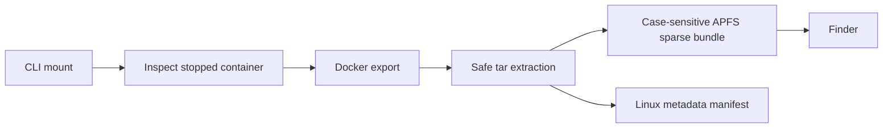
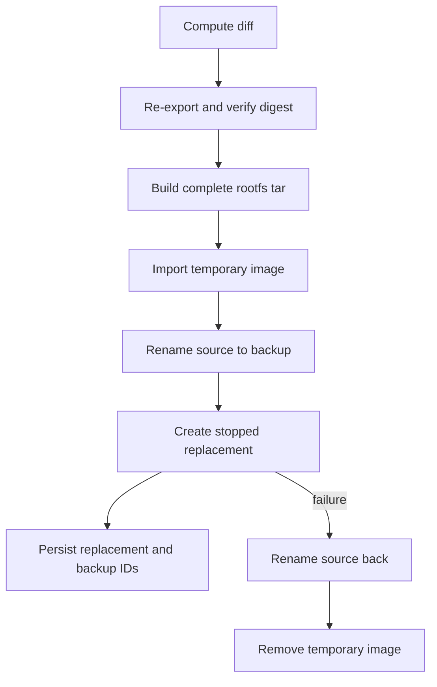

# Architecture

## Компоненты

- `cmd/docker-fs-viewer` — CLI, preview и interactive confirmations.
- `internal/docker` — минимальный Docker Engine API client поверх local Unix socket.
- `internal/workspace` — безопасный tar import/export и macOS APFS backend.
- `internal/session` — атомарно сохраняемые session/manifest JSON.
- `internal/diff` — сравнение Finder workspace с исходным manifest.
- `internal/apply` — consistency check, image import, container replacement и rollback.
- `internal/app` — orchestration use cases.

Platform-independent код не зависит от Finder или `hdiutil`. Текущий `APFS` backend находится в файле с build tag `darwin`; Linux и Windows смогут реализовать такой же lifecycle через собственный volume backend.

## Mount flow

Размер sparse bundle выбирается как `max(2 GiB, 2 * SizeRootFs + 1 GiB)`. Это logical maximum; sparse bundle занимает место по мере записи.

Manifest расположен вне mounted root и не может случайно попасть в replacement. Исходный raw export digest хранится в session для optimistic concurrency check.

## Metadata model

APFS workspace предназначен для редактируемых данных, а manifest является источником Linux semantics:

- исходные UID/GID и mode;
- tar type, symlink/hardlink target;
- device major/minor;
- access/change/modify time;
- xattrs и PAX records;
- SHA-256 regular files.

При сборке replacement tar исходные entries получают metadata из manifest и данные из workspace. Новые entries получают host mode и UID/GID ближайшего известного parent.

Нематериализуемые на macOS special entries отмечаются `virtual` и повторно выдаются из manifest.

## Apply transaction

Container creation body использует исходные `Config` и `HostConfig`, но заменяет image. Network endpoint runtime fields — assigned IP, endpoint ID, gateway и runtime MAC — не копируются; user aliases, IPAM config, links и driver options сохраняются.

Volumes и bind mounts остаются внешними. Docker Engine повторно подключает их по исходному HostConfig.

## Rollback

Rollback разрешён только пока replacement остановлен:

1. удалить replacement без удаления volumes;
2. вернуть исходному container ID исходное имя;
3. удалить imported replacement image;
4. отметить session как `rolled-back`.

Исходный контейнер не удаляется автоматически даже после успешного Apply.

## Consistency and failure boundaries

- Apply блокируется, если source запущен или raw export digest изменился.
- Session и manifest записываются через temporary file + atomic rename.
- Если container creation не удался после rename, исходное имя восстанавливается.
- Если сохранение session state не удалось уже после успешного create, CLI сообщает partial-success с сохранёнными Docker resources.
- Forced unmount доступен явно, обычный unmount не принуждает открытые Finder handles.
